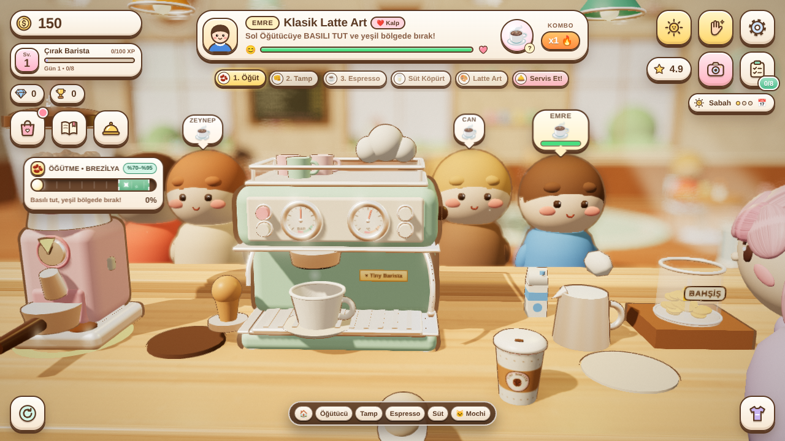
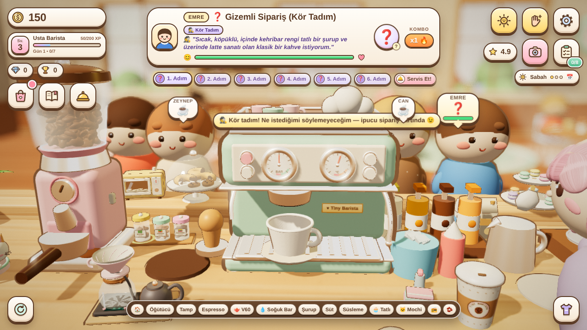
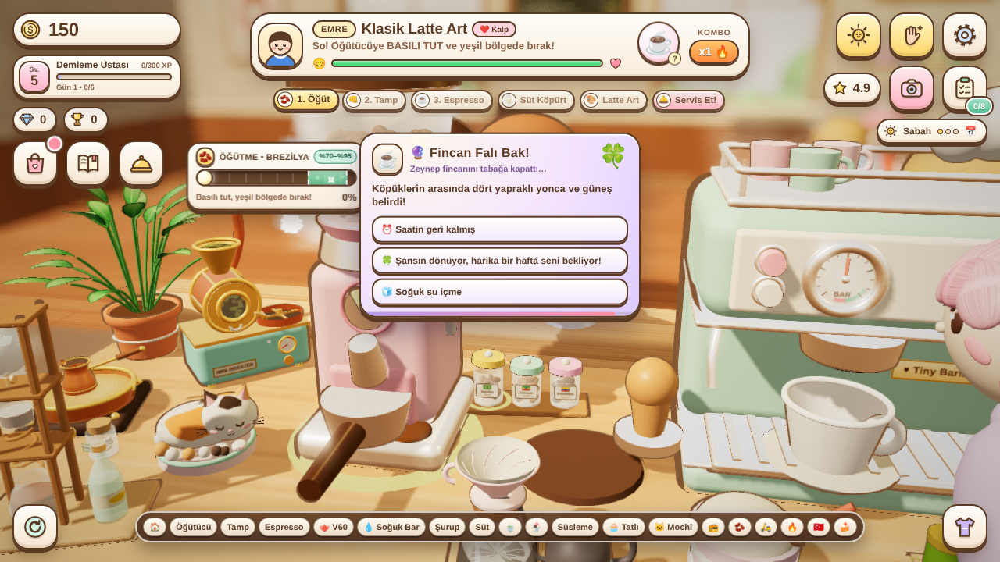
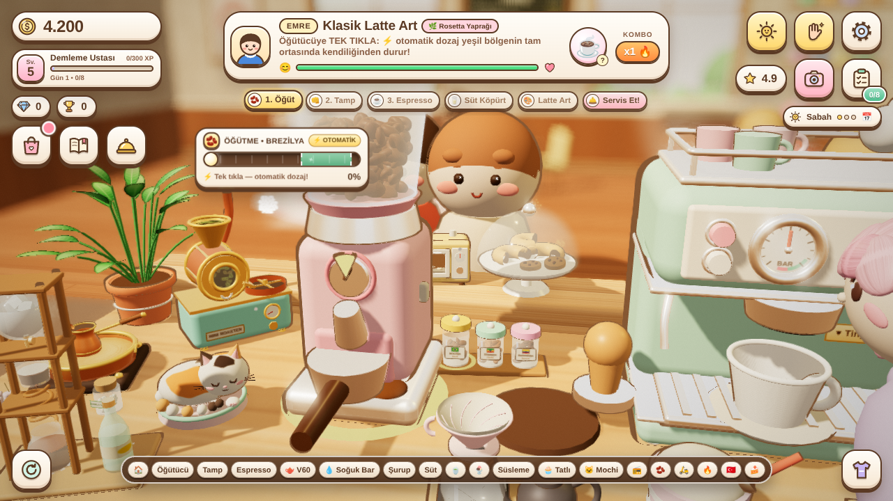
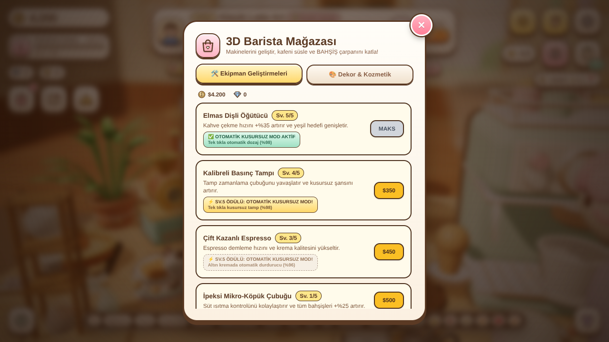
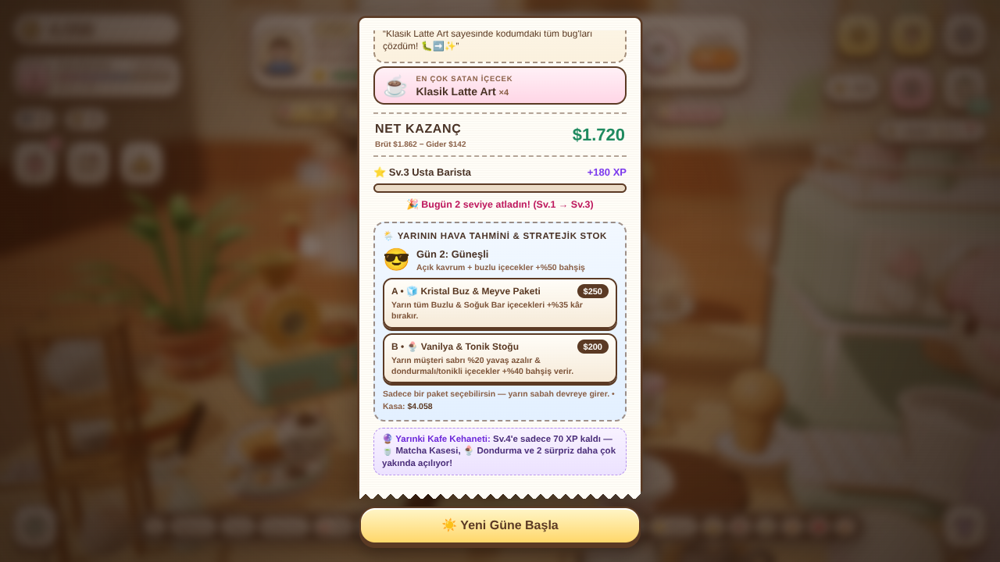

# ☕ Tiny Barista 3D

Three.js (r128) ile yapılmış, tek bir HTML dosyasından oluşan sevimli bir 3D barista oyunu. Tamamen Türkçe.

**Oynamak için:** `index.html` dosyasını tarayıcıda açman yeterli. Kurulum ya da derleme yok; Three.js, TailwindCSS, Fredoka yazı tipi ve FontAwesome CDN'den yüklenir. İlerleme tarayıcının `localStorage` alanına kaydedilir.

## Nasıl oynanır

- Sipariş kartındaki adımları sırayla yap: **Öğüt → Tamp → Espresso → Süt → Latte Art → Servis**.
- Sarı halkalı istasyona tıkla ya da basılı tut (**BOŞLUK** tuşu da çalışır); mini-oyun kartında yeşil bölgeyi yakala.
- Seviye atladıkça tezgaha yeni istasyonlar gelir:
  - **Sv.2:** şurup barı, tatlılar, radyo, çekirdek kavanozları
  - **Sv.3:** V60, Soğuk Bar, süsleme
  - **Sv.4:** matcha, dondurma, moto-kurye
  - **Sv.5:** mini kavurucu, kumda cezve, tatlı vitrini
- Gün sonunda **Z-Raporu** günlük stok giderini düşer; yarının hava tahminine göre bir stratejik stok paketi seçebilirsin.

## v11 yenilikleri

| | |
|---|---|
|  |  |
| **🕵️ Kör Tadım (Sv.3+):** Gizemli siparişte ipucunu oku, doğru istasyonu kendin bul. %85+ → +%50 bahşiş, +15 XP, +1 💎. | **🔮 Fincan Falı (Sv.5+):** Başarılı bir Türk kahvesinden sonra fincandaki sembolü yorumla: doğru yorum +$85 ve +1 💎. |
|  |  |
| **⚡ Usta Otomasyonu:** Öğütücü, Tamp ve Espresso Kazanı Sv.5'te tek tıkla kusursuz çalışır. | Mağazada Sv.5 ödülü etiketleri. |

- Portafilter makineye kilitlenirken dönme animasyonu ve metalik "klak" sesi
- Mini-oyun sürerken kurye ve masa bildirimleri araya girmez
- Z-Raporu'nda **🔮 Yarınki Kafe Kehaneti** satırı

